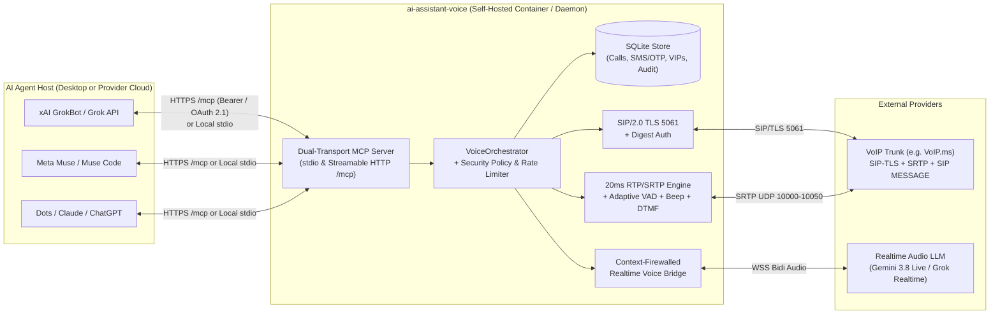

# `ai-assistant-voice`

**Direct SIP-TLS/SRTP-to-Realtime-LLM Telephony & SMS Engine with a Dual-Transport MCP Server**

`ai-assistant-voice` turns any Model Context Protocol (MCP)-capable AI assistant—whether running locally on a desktop or hosted in a provider's cloud (**xAI GrokBot**, **Meta Muse**, **Dots / Claude / ChatGPT**, **Cursor**, **Antigravity**)—into a full-duplex voice & SMS agent directly connected to a SIP trunk such as **VoIP.ms**, with **zero per-minute middleware markups** (no Twilio Voice SDK, Bland, or Vapi fees).

---

## Key Capabilities

- **Direct SIP over TLS (`5061`) + SDES SRTP (`AES_CM_128_HMAC_SHA1_80`)**: End-to-end encrypted signaling and media directly between your host and your SIP trunk, with RFC 3711 64-packet sliding-window anti-replay protection and `/24` Symmetric RTP peer validation.
- **Ultra-Low-Latency Audio-to-Audio Bridge**: Streams 20ms G.711 $\mu$-law RTP frames into **Gemini 3.8 Live** (`models/gemini-3.8-live` via `BidiGenerateContent`) or pluggable Realtime WebSocket models (`xAI Grok Voice Realtime`, `OpenAI Realtime`).
- **Autonomous Outbound Call State Machine**:
  - **Silent Turn 0 on Connect**: Starts in listening mode on `200 OK` so the agent never talks over a human answering `"Hello?"` or collides with the start of an IVR menu.
  - **4.5-Second Dead-Air Fallback**: Automatically sends a gentle `"Hello?"` probe only if 4.5 seconds of silence elapse after call connect.
  - **Hybrid RFC 4733 + In-Band DTMF (`send_dtmf`)**: Navigates phone trees, auto-attendants, and extensions (`0-9`, `*`, `#`, and `w` for 500ms pauses).
  - **Adaptive Patience & Silent Wait (`wait_silently`)**: Dynamically expands VAD endpointing from `700ms` (`human`) to `1,800ms` (`ivr`), `2,200ms` (`voicemail`), or `2,500ms` (`hold`), suppressing all TTS output while menus or greetings are playing.
  - **PBX Discontinuous Transmission (DTX) Watchdog**: Synthesizes silence frames when a remote PBX stops transmitting RTP packets during pauses between IVR prompts.
  - **Narrowband Voicemail Beep Detector**: Detects `800–1200 Hz` single-frequency tones (`300–1000 ms`) and injects `[VOICEMAIL BEEP DETECTED]` so the agent leaves a clean message right after the tone.
- **Inbound AI Receptionist & VIP Auto-Transfer**: Screens unknown callers, records structured messages, and blind-transfers (`SIP REFER`) known VIP callers to your direct extension or mobile.
- **Bidirectional SMS & Automatic 2FA/OTP Extraction**: Sends and receives SMS over `SIP MESSAGE` (and provider webhooks) and automatically extracts 4–8 digit verification codes so your agent can complete 2FA flows autonomously.
- **Context Firewall & Hardened Security Defaults**: Isolates the PSTN voice sub-agent to an explicit `objective` and `approved_facts` dictionary—blocking indirect prompt injection over phone audio or SMS from accessing your primary agent's private tools, files, or memory.

---

## Architecture



---

## Quickstart

### 1. Install

```bash
python3 -m venv .venv
source .venv/bin/activate
pip install -e ".[dev]"
```

### 2. Configure `.env`

Copy [`.env.example`](.env.example) to `.env` and fill in your SIP subaccount and Realtime LLM API key:

```bash
cp .env.example .env
# Generate a 256-bit Bearer token if exposing HTTP MCP to cloud agents:
python3 -c "import secrets; print('AI_VOICE_MCP_TOKEN=' + secrets.token_urlsafe(32))" >> .env
```

### 3. Run the MCP Server

**Option A — Desktop (`stdio`) Mode** (for local Claude Desktop, Muse Code, Grok CLI, Cursor, Antigravity):
```bash
ai-assistant-voice --transport stdio
```

**Option B — Hosted (`Streamable HTTP`) Mode** (for provider-hosted GrokBot, Meta Muse Cloud, Dots, Claude/ChatGPT Custom Connectors):
```bash
ai-assistant-voice --transport http --host 127.0.0.1 --port 8400
```
*(Expose `127.0.0.1:8400` externally via a TLS-terminating reverse proxy or Cloudflare Zero Trust Tunnel—see [docs/AGENT_INTEGRATIONS.md](docs/AGENT_INTEGRATIONS.md) and [docs/SECURITY.md](docs/SECURITY.md)).*

**Option C — Hardened Docker Compose**:
```bash
docker compose up -d --build
```

---

## Exposed MCP Tools

| Tool Name | Purpose |
| :--- | :--- |
| `voice_call_outbound` | Place an autonomous outbound call with a Context-Firewalled `objective` and `approved_facts`, Silent Turn 0, IVR DTMF navigation, and voicemail handling. |
| `voice_get_call` | Retrieve live status, structured outcome, DTMF history, and turn-by-turn transcript for a `call_id`. |
| `voice_list_calls` | List recent inbound and outbound call logs (`limit`, `direction`). |
| `voice_send_dtmf` | Send RFC 4733 + in-band DTMF digits (`0-9`, `*`, `#`, `w` pause) on an active call. |
| `voice_hangup_call` | Disconnect an active call immediately. |
| `voice_send_sms` | Send an outbound SMS message via the configured VoIP DID. |
| `voice_list_sms` | List recent SMS messages or filter specifically for extracted 2FA/OTP codes (`only_otp=true`). |
| `voice_manage_vip_client` | Add, update, or list VIP clients on the inbound receptionist auto-transfer allowlist. |
| `voice_system_status` | Inspect SIP/SRTP posture, active calls, and remaining hourly rate-limit budgets. |

---

## Documentation Index

1. **[VoIP Provider Requirements & VoIP.ms Configuration Guide](docs/VOIP_PROVIDERS.md)**
   - Exact checklist of what is required from a SIP provider (SIP-TLS, SDES SRTP, G.711 PCMU, RFC 4733 DTMF, SIP MESSAGE SMS, SIP REFER).
   - Step-by-step **VoIP.ms** subaccount, DID, TLS/SRTP, and SMS setup with a ready-to-use configuration template.
2. **[Agent Integration Guide: GrokBot, Meta Muse, Dots, Claude & ChatGPT](docs/AGENT_INTEGRATIONS.md)**
   - How **provider-hosted cloud agents** vs. **desktop agents** connect to `ai-assistant-voice`.
   - Ready-to-copy configurations for **xAI GrokBot / Grok API**, **Meta Muse / Muse Code**, **Dots / Claude / ChatGPT Custom Connectors**, and **Antigravity**.
3. **[Security Architecture & Deep Security Review](docs/SECURITY.md)**
   - Threat model, MCP transport security (Bearer / OAuth 2.1 RFC 9728 / Cloudflare Access), Context Firewall design, PSTN prompt-injection defense, SRTP anti-replay, Symmetric RTP subnet pinning, and Deep Security Audit report.
